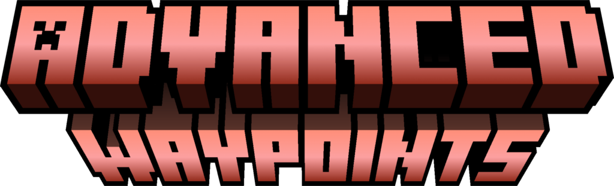

<div align="center">



[](https://github.com/MusiJVR/AdvancedWaypoints/releases)
[](https://modrinth.com/plugin/advancedwaypoints)
[](https://github.com/MusiJVR/AdvancedWaypoints/blob/main/LICENSE)

[](https://bukkit.org/)
[](https://spigotmc.org/)
[](https://papermc.io/software/paper)
[](https://papermc.io/software/folia)
[](https://purpurmc.org/)

</div>

## 🌐 Overview

**AdvancedWaypoints** is a plugin that adds customizable waypoints to Minecraft's **Locator Bar**.

The plugin allows players to create, manage and display custom waypoint markers with different styles. Waypoint icons are provided through a generated resource pack, while the plugin handles their creation, management and synchronization.

The resource pack is generated automatically by the plugin and contains all required textures and waypoint style definitions.

> **Note:** All technical settings and features described here are intended for the latest version of the plugin and may not be fully compatible with older versions.

## 📜 Commands

Here are all the commands that can be used in the plugin:
* `/point help` - This command allows you to display all possible plugin commands
* `/point reload` - This command allows you to reload the plugin config
* `/point resourcepack <action>` - This command allows you to generate a resource pack with custom waypoints
* `/point limit <player> <limit>` - This command allows you to set a limit on waypoints for a player
* `/point personal <action> [args]` - This command allows you to manage a personal waypoint
* `/point create <style>` - This command allows you to create a custom waypoint
* `/point remove <uuid>` - This command allows you to remove a custom waypoint
* `/point list [page]` - This command allows you to view a list of your custom waypoints
* `/point modify <uuid> <action> [args]` - This command allows you to modify a custom waypoint

## 📦 Resource pack

**AdvancedWaypoints** uses a custom resource pack to add waypoint icons to Minecraft's Locator Bar.

The plugin provides a set of default waypoint icons that can be generated automatically using the `/point resourcepack generate` command.

You can also add your own waypoint textures to the plugin's resource pack directory. Once your textures are ready, use the `/point resourcepack build` command to generate the final resource pack.

### Resource pack structure

The generated resource pack uses the following structure:

```
plugins/AdvancedWaypoints/resourcepack/
├── assets/
│   ├── <style>/
│   │   ├── <style>_0.png
│   │   ├── <style>_1.png
│   │   └── ...
│   └── <another_style>/
│       ├── <another_style>_0.png
│       ├── <another_style>_1.png
│       └── ...
└── build/
    └── resourcepack.zip
```

## ⚙️ Settings for developers or administrators

The plugin has permissions:

| **Permissions**                     | **Meaning**                                  | **Default access** |
|-------------------------------------|----------------------------------------------|--------------------|
| `advancedwaypoints.update_listener` | Permission to receive update `notifications` | `op`               |
| `advancedwaypoints.use`             | Permission to use commands                   | `true`             |
| `advancedwaypoints.help`            | Permission to use command `help`             | `true`             |
| `advancedwaypoints.reload`          | Permission to use command `reload`           | `op`               |
| `advancedwaypoints.resourcepack`    | Permission to use command `resourcepack`     | `op`               |
| `advancedwaypoints.limit`           | Permission to use command `limit`            | `op`               |
| `advancedwaypoints.personal`        | Permission to use command `personal`         | `true`             |
| `advancedwaypoints.create`          | Permission to use command `create`           | `true`             |
| `advancedwaypoints.remove`          | Permission to use command `remove`           | `true`             |
| `advancedwaypoints.list`            | Permission to use command `list`             | `true`             |
| `advancedwaypoints.modify`          | Permission to use command `modify`           | `true`             |

## ❗ Issues

Please leave messages about any errors you find [here](https://github.com/MusiJVR/AdvancedWaypoints/issues) or on the [Discord](https://discord.gg/xY8WJt7VGr)

## 💬 Social Media

- Page on [Modrinth](https://modrinth.com/plugin/advancedwaypoints)
- Page on [GitHub](https://github.com/MusiJVR/AdvancedWaypoints)
- Page on [Discord](https://discord.gg/xY8WJt7VGr)

## 📊 Metrics

<div align="center">

[](https://bstats.org/plugin/bukkit/AdvancedWaypoints/35003)

</div>
